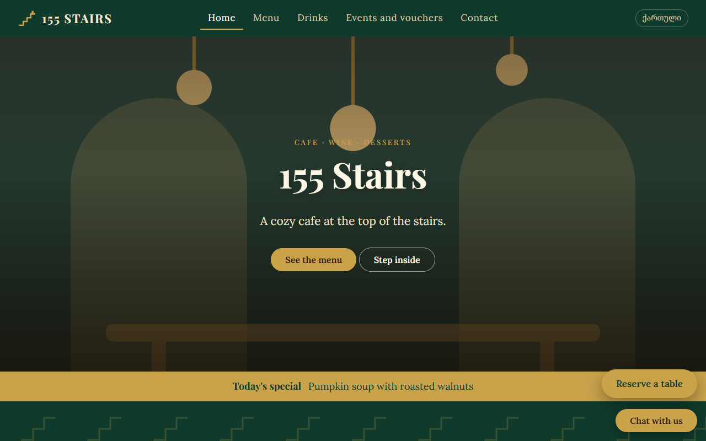
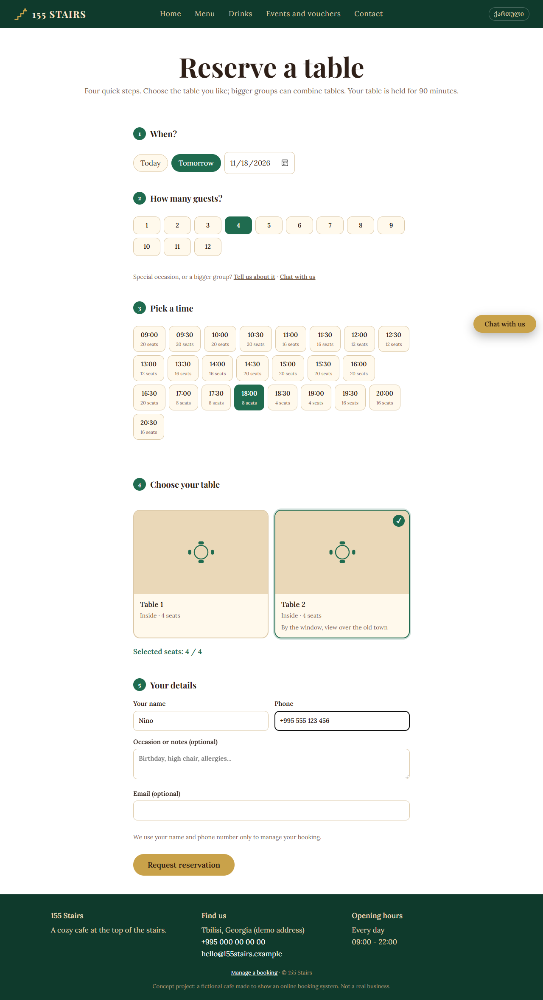
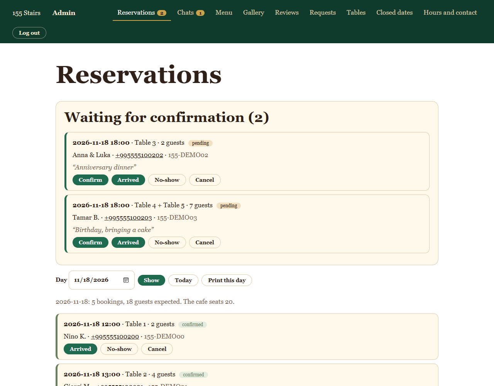
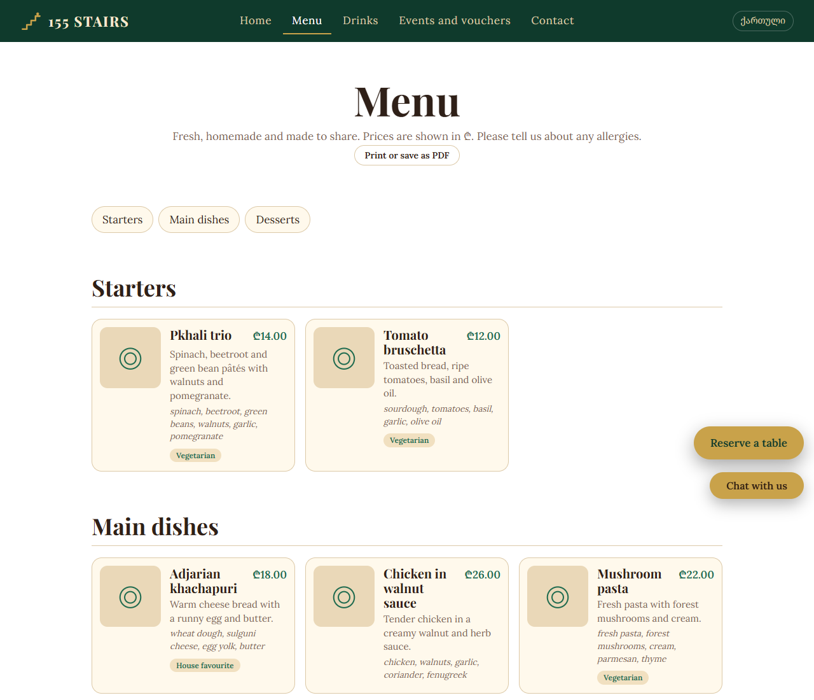
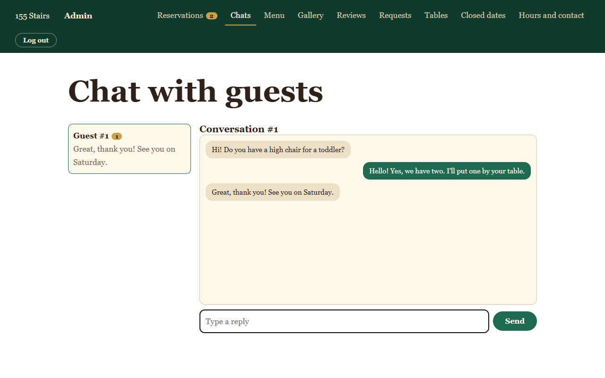
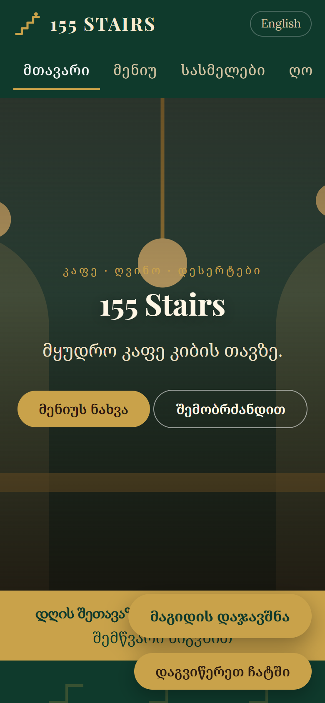

# 155 Stairs: café website with table booking

A full website for **155 Stairs**, a made-up café in Tbilisi, Georgia: a public site for guests and an admin panel for the owner. Built with **Python, Flask and SQLite**, no front-end framework.

> Concept project for my portfolio. The café, address and phone number are not real.



## Screenshots

| Booking: pick a time, then a table | Owner's reservations list |
|---|---|
|  |  |

| Menu | Live chat (admin side) | Georgian, on a phone |
|---|---|---|
|  |  |  |

The screenshots use sample data. To take them again after changing the design: `pip install playwright`, then `python scripts/screenshots.py` (it uses a temporary database and the Edge browser already on Windows).

## Features

**For guests**
- Home page with an "about" story, featured dishes, a photo gallery and reviews
- Food and drinks menus with categories, diet labels (vegetarian, vegan, gluten-free, nuts), ingredients and "sold out" badges
- **Table booking:** pick a date, a time and the number of guests, then choose from the tables that are free (inside or outside, with photos). Bigger groups can combine tables.
- Look up or cancel a booking with the reference number and phone number
- **Live chat** with the café
- Requests for private events and gift vouchers
- **English and Georgian** (switch at the top of every page)

**For the owner (`/admin`)**
- Reservations by day, with confirm / arrived / no-show / cancel, plus staff bookings for walk-ins and phone calls
- Menu editor with photo upload; tables editor; opening hours; closures (whole day or part of a day)
- Gallery, reviews, chat inbox and event requests
- Brand colors, font style and the café's text, all editable without touching code
- Optional alerts for new bookings and messages by **Telegram** or **email**

## Booking rules

- A booking holds its tables for 90 minutes (editable).
- A table counts as taken while a booking is pending, confirmed or arrived; cancelling frees it.
- Guests can't pick more tables than their group needs.
- One phone number can't hold two overlapping bookings, or more than 3 upcoming ones.
- Bookings are saved inside a database lock (`BEGIN IMMEDIATE`), so two people can't take the same table at the same moment.

## Security

- Admin password stored as a salted hash; login limited to 5 tries per 10 minutes
- Protection tokens (CSRF) on every form, public and admin, so other websites can't submit forms in a visitor's name
- The booking confirmation page opens only in the browser that made the booking; anyone else must give the reference **and** the phone number
- Uploaded photos checked by file contents, not just the file name, and saved under random names; files are deleted from disk once nothing uses them
- Hidden "honeypot" field against spam bots; rate limits on chat, booking lookups, cancellations and event requests
- Secure cookies and security headers in production; the app refuses to start in production with the default password

## Tech stack

| Part | Used |
|---|---|
| Back end | Python 3, Flask 3 |
| Database | SQLite (created automatically on first run) |
| Front end | Jinja templates, plain CSS and JavaScript |
| Server | Gunicorn (production) |

## Run it locally (Windows)

```
python -m venv venv
venv\Scripts\activate
pip install -r requirements.txt
python app.py
```

Open http://127.0.0.1:5000. The admin panel is at http://127.0.0.1:5000/admin, and the default password is `admin123`; change it before putting the site online.

On macOS or Linux, use `source venv/bin/activate` instead of the second line.

## Tests

```
pip install -r requirements-dev.txt
python -m pytest
```

65 pytest tests cover the booking rules (table clashes, group sizes, opening hours, closures, the 3-booking limit, staff table allocation) and the security fixes (CSRF, the private confirmation page, rate limits, admin login lockout, photo upload checks and clean-up). Each test runs against its own temporary database and uploads folder, so your real data is never touched.

## Project structure

```
app.py            back end: routes, booking logic, admin
i18n.py           Georgian translations of the site text
seed_text.py      starting menu content
templates/        HTML pages (Jinja)
static/css, js/   styles and scripts
static/uploads/   uploaded photos (not in Git)
tests/            pytest tests
scripts/          screenshots.py (README screenshots)
docs/screenshots/ README images
data/cafe.db      database (created on first run, not in Git)
```

## Putting it online

Set these environment variables: `PRODUCTION=1`, `SECRET_KEY` (a long random string) and `ADMIN_PASSWORD`. Start command: `gunicorn app:app`.

The database and photos are files, so use a host with a **persistent disk**, and point `DB_PATH` and `UPLOAD_DIR` at it. On many free hosts, files are wiped on every restart.

**Optional alerts**
- Telegram: create a bot with @BotFather, then set `TELEGRAM_BOT_TOKEN` and `TELEGRAM_CHAT_ID`.
- Email: set `SMTP_HOST`, `SMTP_PORT` (587), `SMTP_USER`, `SMTP_PASSWORD` and `NOTIFY_EMAIL`.

## Roadmap

- [x] Screenshots in this README
- [x] Automated tests for the booking rules and security fixes
- [x] CSRF protection on the public forms too
- [x] Private booking confirmation page
- [x] Clean up unused photo files
- [ ] Split `app.py` into smaller modules (Flask blueprints)
- [ ] Live demo
- [ ] Online deposit for bookings (needs a Georgian payment provider such as Bank of Georgia iPay or TBC Checkout)
